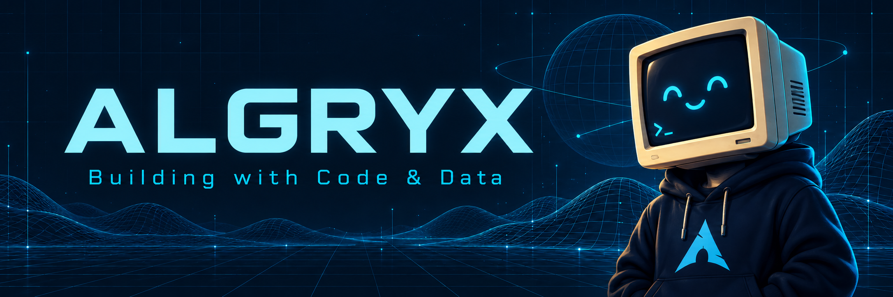
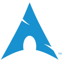
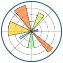

  

<h1 align="center">Hey, I'm Algryx 👋</h1>
<h3 align="center">Data Science &amp; AI</h3>

AI &amp; Data Science · Software Development

## `01` · About me

I'm interested in the space where software and data meet. AI and data science are my main focus, and I'm working toward a future in AI engineering.

Python, Java, C++, and SQL form my programming foundation. I want to understand not just how to write code, but how to organize it, reason about it, and use it to solve problems.

My interests also extend to backend development and APIs: how applications exchange information, how databases fit into a system, and how the pieces work together. FastAPI and PostgreSQL are part of my toolkit, alongside Git and Docker.

I enjoy exploring Linux, development environments, and automation. I'm interested in ways to make routine work simpler and in open-source software as a place to study how other people build things.

Cybersecurity is another area I'm curious about, especially how it connects to the software and systems I use. For now, I'm building a broad technical foundation while keeping AI engineering as my direction.

<em>Turning ideas into code, and data into insight.</em>

## `02` · Languages

  &nbsp;&nbsp;
  &nbsp;&nbsp;
  &nbsp;&nbsp;
  &nbsp;&nbsp;
  &nbsp;&nbsp;
  &nbsp;&nbsp;
  &nbsp;&nbsp;
  &nbsp;&nbsp;

## `03` · Things and tools that I use

  &nbsp;&nbsp;
  &nbsp;&nbsp;
  &nbsp;&nbsp;
  &nbsp;&nbsp;
  &nbsp;&nbsp;
  &nbsp;&nbsp;
  &nbsp;&nbsp;
  &nbsp;&nbsp;
  &nbsp;&nbsp;
  &nbsp;&nbsp;
  &nbsp;&nbsp;

## `04` · Libraries I’m exploring

  &nbsp;&nbsp;
  &nbsp;&nbsp;
  &nbsp;&nbsp;
  &nbsp;&nbsp;
  &nbsp;&nbsp;

## `05` · Connect

[**X · @itsalgryx**](https://x.com/itsalgryx) &nbsp; / &nbsp; [**Instagram · @itsalgryx**](https://www.instagram.com/itsalgryx/) &nbsp; / &nbsp; [**Email · algryx@hotmail.com**](mailto:algryx@hotmail.com)

---

<code>&gt; Data Science &amp; AI_</code>

Tool logos: Devicon. See <a href="CREDITS.md">asset credits</a>.
